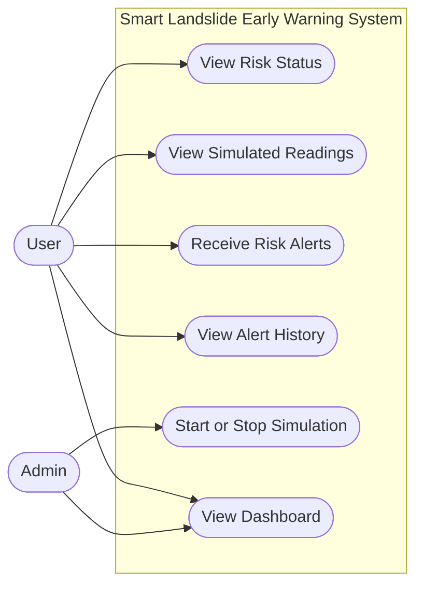
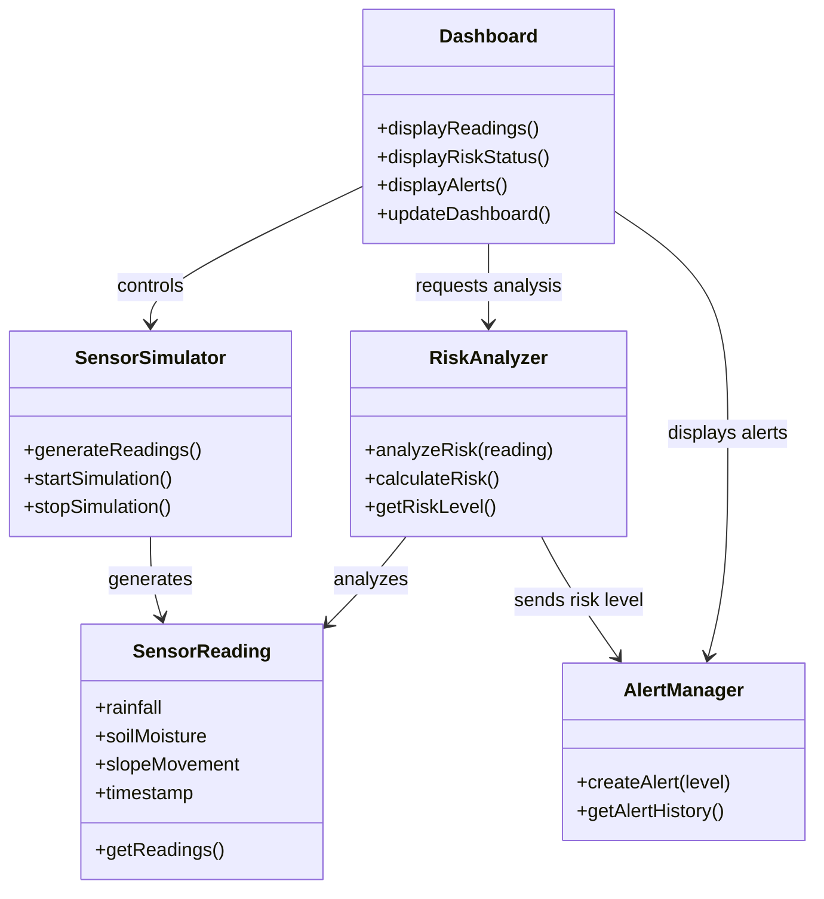
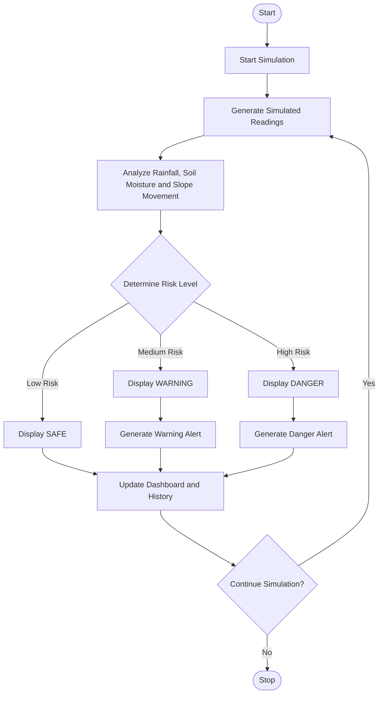

# Smart Landslide Early Warning System (SLEWS)

A software-based landslide risk monitoring and early warning prototype using simulated environmental data.

> **Project note:** This is an academic software prototype. It generates simulated readings and demonstrates risk classification. It does not use physical sensors or hardware and must not be used for real-world emergency decisions.

| | |
|---|---|
| **Project Name** | Smart Landslide Early Warning System (SLEWS) |
| **Student Name** | MD Samir Tahrian |
| **Student ID** | IT 24007 |
| **Project Type** | Software-based simulation |
| **Main Purpose** | Simulate environmental readings and display landslide risk levels |

## Overview

The Smart Landslide Early Warning System is designed to demonstrate how simulated environmental data can be used to identify possible landslide risk levels. The system generates sample values for rainfall, soil moisture, and slope movement, analyzes the readings, and displays a risk status on a dashboard.

The system classifies the simulated risk into three levels:

- **SAFE** — the simulated readings indicate a low risk.
- **WARNING** — the simulated readings indicate a medium risk.
- **DANGER** — the simulated readings indicate a high risk.

## Objectives

- Generate simulated environmental readings.
- Analyze rainfall, soil moisture, and slope movement values.
- Classify the simulated risk level.
- Display risk status and simulated readings on a dashboard.
- Generate sample alerts and maintain alert history.
- Demonstrate the system design through UML diagrams.

## Main Features

- Simulated environmental readings
- Risk-level analysis
- SAFE, WARNING, and DANGER status display
- Sample risk alerts
- Alert history
- Dashboard view
- Start/stop simulation control
- UML system documentation

## System Diagrams

The following diagrams describe the system's main interactions, software classes, and workflow. They are written in Mermaid, so GitHub can display them directly in this README.

### 1. Use Case Diagram

Shows how the User and Admin interact with the system, including viewing risk status, simulated readings, alerts, alert history, and the dashboard.



### 2. Class Diagram

Shows the main software classes and their responsibilities: `Dashboard`, `SensorSimulator`, `SensorReading`, `RiskAnalyzer`, and `AlertManager`.



**How to read this diagram**

| Class | Responsibility |
|---|---|
| `Dashboard` | Main screen. Controls the simulation, requests analysis, and shows readings, risk status, and alerts. |
| `SensorSimulator` | Generates simulated readings and starts/stops the simulation. |
| `SensorReading` | Holds one set of values: rainfall, soil moisture, slope movement, and timestamp. |
| `RiskAnalyzer` | Analyzes a reading and determines the risk level (SAFE, WARNING, DANGER). |
| `AlertManager` | Creates alerts from the risk level and keeps the alert history. |

### 3. Activity Diagram

Shows the simulation workflow: generate readings, analyze environmental values, determine the risk level, display the appropriate status, update the dashboard and history, and continue or stop the simulation.



## Risk Analysis Workflow

1. Start the simulation.
2. Generate simulated rainfall, soil moisture, and slope movement values.
3. Analyze the generated readings.
4. Determine the risk level.
5. Display SAFE, WARNING, or DANGER.
6. Generate a sample alert when appropriate.
7. Update the dashboard and alert history.
8. Continue or stop the simulation.

> **Important:** The thresholds and readings used by this prototype are illustrative. They have not been validated for actual landslide prediction.

## Technologies and Tools

The project is designed as a software-only prototype. The specific implementation technologies can be listed here according to the version of the project you submit.

- HTML, CSS, and JavaScript — for a browser-based prototype, if used
- UML — for system design and documentation
- Git and GitHub — for version control and project hosting

## Project Structure

```
Smart-Landslide-Early-Warning-System/
└── README.md
```

If you add the prototype, proposal, or other source files, include them in the repository and update this structure to match the actual files.

## How to View the Diagrams

1. Open this repository on GitHub.
2. Open `README.md`.
3. Scroll to **System Diagrams**.
4. GitHub will draw all three diagrams automatically from the Mermaid code in this README. No image files are required.

## Future Improvements

- Add a more detailed simulation model.
- Allow users to adjust simulation parameters.
- Store simulation history persistently.
- Add downloadable reports and charts.
- Test the risk-classification rules against reliable, validated datasets before considering any real-world use.

## Limitations

- The system uses simulated data, not real sensor readings.
- The risk categories are for demonstration only.
- The prototype is not a certified landslide prediction or public-warning system.
- Real-world deployment would require validated models, reliable data, field testing, and expert review.

## Academic Use

This repository documents an academic software project and its UML diagrams. Review the project files and diagrams to understand the proposed design and workflow.
